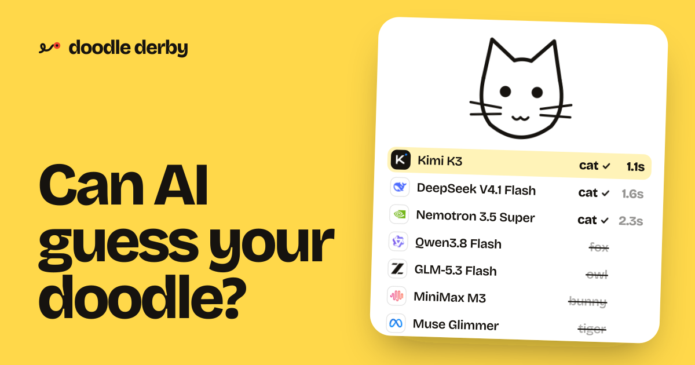

<a href="https://doodle-derby-eight.vercel.app">
  
  <h1 align="center">Doodle Derby</h1>
</a>

  Draw a word and watch seven open vision models race to guess it live. Powered by Together AI.

## Tech stack

- [Together AI](https://www.together.ai) for inference, with seven vision models from seven labs: Kimi K3, Qwen3.8 Flash, GLM-5.3 Flash, MiniMax M3, DeepSeek V4.1 Flash, Muse Spark and Nemotron 3.5 Super
- GLM-5.3 Flash as the referee for guesses the synonym list can't settle
- [Upstash Redis](https://upstash.com) for the global leaderboard, the daily board and share links
- Next.js app router with Tailwind and Motion
- [Mediabunny](https://mediabunny.dev) to turn each round into a shareable video, right in the browser
- Vercel for hosting

## How it works

1. You draw on a canvas. Every bit of new ink, each model gets a small snapshot of the sketch.
2. All seven models stream their guesses at once, with thinking switched off so they answer in about a second.
3. Each guess is judged on the server, and the first correct one wins the round.
4. Every result goes to a global leaderboard, and a daily word lets everyone compete on the same drawing.

## Cloning & running

1. Clone the repo: `git clone https://github.com/Nutlope/doodle-derby`
2. Create a `.env.local` file and add your [Together AI API key](https://api.together.ai/settings/api-keys): `TOGETHER_API_KEY=`
3. Optionally add `KV_REST_API_URL` and `KV_REST_API_TOKEN` from [Upstash](https://upstash.com) for a shared leaderboard (without them it saves to `.data/` locally)
4. Run `pnpm install` and `pnpm dev` to install dependencies and run locally
